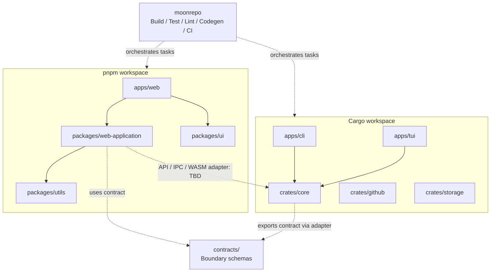
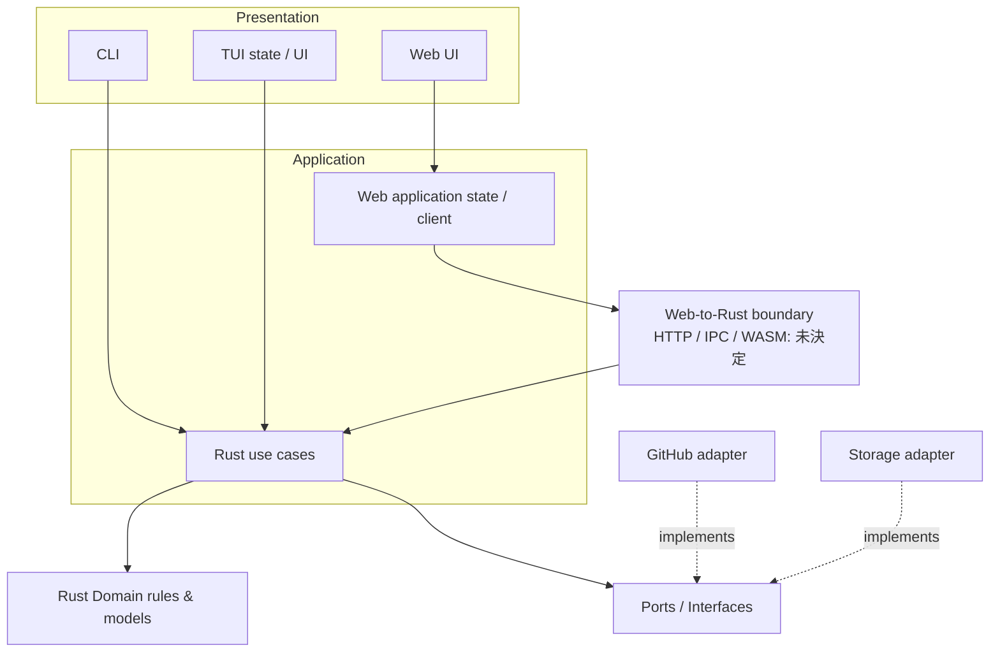
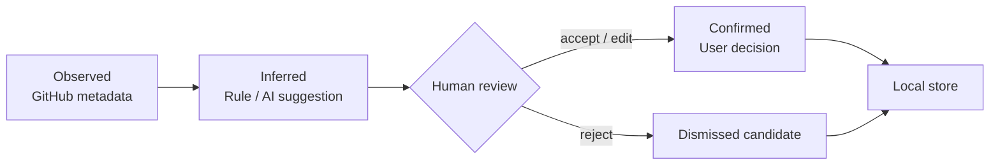
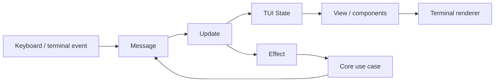
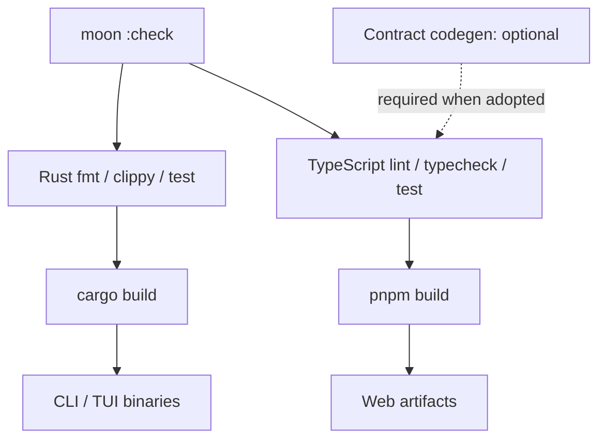
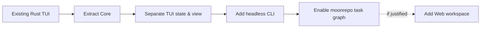

# RepositoriesManager アーキテクチャ設計

> Status: Draft / Architecture Proposal  
> 対象: `UtakataKyosui/RepositoriesManager`  
> 最終更新: 2026-10-12

## 1. 目的と前提

RepositoriesManagerは、GitHubリポジトリの一覧・メタデータ編集を出発点として、**目的・役割・状態・相互関係を整理し、維持・統合・アーカイブ・削除の意思決定を支援する**ツールである。

この文書は**構造と責務の方針**を定義する。分類アルゴリズム、最終的なMVP機能、Web実行方式や配布方法の確定は別途要件定義・ADRに委ねる。

### 1.1 設計目標

| ID | 目標 | 判断基準 |
|---|---|---|
| G-01 | CLI・TUI・将来のWebが同じドメイン規則を利用できる | 分類規則がUI内に重複実装されない |
| G-02 | Rust・TypeScriptそれぞれの標準的なワークスペース管理を維持する | CargoがRust依存を、pnpmがJS/TS依存を管理する |
| G-03 | タスクを横断して実行・キャッシュできる | moonrepoからbuild/test/lintなどを起動できる |
| G-04 | 取得事実・推測・人間の確定判断を混同しない | provenanceと判定根拠を保持できる |
| G-05 | 既存Rust TUIから段階的に移行する | 既存の一覧・Description/Topics編集を退行させない |
| G-06 | 破壊的操作の誤実行を防ぐ | 分析と削除の境界が明確で、明示確認なしに削除しない |

### 1.2 非目標（初期段階）

- Web UIの本番運用を開始すること。
- LLMによる自律的なリポジトリ削除・統合。
- Rust Coreの全機能をブラウザで直接実行すること。
- RustとTypeScriptで同じ分類ルールを二重に管理すること。
- moonrepoをCargoやpnpmの代替パッケージマネージャーとして利用すること。

## 2. ワークスペースの責務

| 管理領域 | 管理対象 | 主な責務 | 責務ではないもの |
|---|---|---|---|
| **Cargo Workspace** | `apps/cli`, `apps/tui`, `crates/*` | Rustパッケージ、Domain/Application、GitHub・永続化アダプター、CLI/TUI | WebのReactコンポーネントやpnpm依存管理 |
| **pnpm Workspace** | `apps/web`, `packages/*` | Webアプリ、Web側ユースケースの接続、UIコンポーネント、表示用ユーティリティ | Rustのビジネスルールの再実装 |
| **moonrepo** | 両ワークスペースの各プロジェクト・タスク | build/test/lint/typecheck/codegen/CIの実行順序とキャッシュ | ドメインモデル、実行時DI、Cargo/pnpmのロックファイル管理 |



> 注記: 点線は**設計上の接続候補**であり、TypeScriptがRust Crateを直接importできることを意味しない。

## 3. 推奨ディレクトリ構成

```text
RepositoriesManager/
├── .moon/
│   ├── workspace.yml
│   ├── toolchains.yml
│   └── tasks/
│       ├── rust.yml
│       └── typescript.yml
├── apps/
│   ├── cli/                      # Rust: 非対話コマンド・機械可読出力
│   │   ├── Cargo.toml
│   │   └── src/main.rs
│   ├── tui/                      # Rust: 対話型ターミナルアプリ
│   │   ├── Cargo.toml
│   │   └── src/
│   │       ├── main.rs
│   │       ├── app.rs            # State / Update / Effects
│   │       ├── event.rs          # キー入力などのイベント変換
│   │       └── ui/              # 描画専用
│   │           ├── mod.rs
│   │           ├── screens/
│   │           ├── components/
│   │           └── theme.rs
│   └── web/                      # 将来追加: pnpm
├── crates/
│   ├── core/                     # Domain + Application (初期は同一Crate可)
│   │   └── src/
│   │       ├── domain/
│   │       ├── application/
│   │       └── ports/
│   ├── github/                   # GitHub API / gh adapter
│   └── storage/                  # ローカル永続化 adapter
├── packages/
│   ├── web-application/          # Webの状態・API接続・ViewModel
│   ├── ui/                       # Web UI コンポーネント
│   └── utils/                    # TS汎用ユーティリティ
├── contracts/
│   └── schemas/                  # Web-Rust間の境界契約（方式未決定）
├── docs/
│   ├── REQUIREMENTS.md
│   ├── ARCHITECTURE.md
│   └── adr/
├── Cargo.toml
├── Cargo.lock
├── package.json
├── pnpm-workspace.yaml
├── pnpm-lock.yaml
└── README.md
```

**導入方針:** このツリーは到達目標であり、空パッケージを最初からすべて作らない。既存TUIと`crates/core`を先行して分離し、CLIやWebの具体的な要件が生じた段階で追加する。

## 4. レイヤーと依存方向

| レイヤー | モジュール例 | 役割 | 禁止・制約 |
|---|---|---|---|
| Presentation | `apps/cli`, `apps/tui/src/ui`, `apps/web`, `packages/ui` | 入出力・描画・ユーザー操作 | 分類規則・GitHub API直接アクセスを画面に混在させない |
| Application | `crates/core/application`, `packages/web-application` | ユースケース、操作の調停、Web状態・ViewModel | Web側にRust Domainのビジネス規則を複製しない |
| Domain | `crates/core/domain` | Repository、分類、関係性、整合性ルール | Ratatui、React、GitHub HTTP仕様に依存しない |
| Infrastructure | `crates/github`, `crates/storage` | GitHub・ローカル保存の実装 | UI仕様を知る必要がない |



依存性逆転を適用する。Use CaseはGitHub SDKやDB実装を直接構築せず、Port経由で利用する。具体的なインスタンス生成は実行入口（composition root）で行う。

## 5. ドメインモデルと分類情報

### 5.1 概念

| 概念 | 説明 | 例 |
|---|---|---|
| Repository | GitHub上の識別対象 | `UtakataKyosui/bookshelf` |
| Type | 成果物の形態 | application / library / cli / template / learning |
| Domain | 用途・テーマ（複数可） | book-management / developer-tools |
| Lifecycle | 人間が管理するライフサイクル | active / paused / completed / superseded / abandoned |
| Relation | リポジトリ間の意味的関係 | superseded-by / component-of / related-to / duplicate-candidate |
| Observation | APIやGitから観測した事実 | archived、updated_at、topics |
| Inference | 機械が提案した判断 | 「目的が近い」候補と根拠 |
| Confirmation | ユーザーが確定した判断 | 正本は`ios-bookshelf` |

**重要:** `updated_at`が古いことと、`abandoned`であることは同義ではない。`duplicate-candidate`は確認前の候補であり、確定した重複関係とは別に扱う。

### 5.2 データの出所（provenance）



最低限、推論結果には`reason`（根拠）、`source`（rule/AI）、`status`（pending/accepted/rejected）を持たせる。信頼度スコアは、正しく較正できる段階まで必須項目にしない。

## 6. CLI / TUI / Webそれぞれの境界

### 6.1 CLI

- 引数とコマンドを解釈し、Coreのユースケースを起動する。
- `--format json`等で機械可読出力を提供し、標準出力に装飾ログを混ぜない。
- 非対話モードは確認が必要な変更を暗黙に実行しない。
- 将来の`gh` Extension対応はコマンド仕様と配布要件を別途定義する。

### 6.2 TUI

State / Message / Update / View + Effect（Elm Architecture風）で分離する。



- `ui/`は状態を受け取って描画する。API取得・ファイルIO・ドメイン判定を持たない。
- `app.rs`は状態遷移、イベント処理、Effectの依頼を調停する。
- 共通UIをWebの`packages/ui`と無理に共有しない（描画基盤が異なる）。

### 6.3 Web

- `packages/web-application`にはクライアントの状態、API接続、ViewModelなどを置く。
- `packages/ui`はReactコンポーネントと見た目・操作に集中する。
- `packages/utils`はドメイン規則を含まない汎用処理に限定する。
- Rust Coreとの接続は**未決定**。Web実装の着手前にADRで選択する。

| 選択肢 | 向く状況 | 注意点 |
|---|---|---|
| HTTP API | ブラウザWebとCLI/TUIを独立運用 | APIのデプロイ、認証、CORS、運用コスト |
| Tauri IPC | デスクトップアプリにWeb UIを組み込む | Web単独配信には別経路が必要 |
| WASM | 純粋な分類アルゴリズムをブラウザで動かす | GitHub認証・IO・ストレージは別実装が必要 |

**暫定原則:** Webに必要なのが分類結果の表示だけなら、JSONエクスポートを読む静的UIでもよい。実行時にRust Coreを呼ぶ必要があるとは限らない。

## 7. ワークスペース設定（設計例）

> 以下は構成イメージ。moonrepoの使用バージョン・タスク設定の厳密な構文は導入時に公式ドキュメントと実機で検証する。

### 7.1 Cargo

```toml
# Cargo.toml
[workspace]
resolver = "3"
members = [
  "apps/cli",
  "apps/tui",
  "crates/*",
]
```

### 7.2 pnpm

```yaml
# pnpm-workspace.yaml
packages:
  - "apps/web"
  - "packages/*"
```

### 7.3 moonrepo

```yaml
# .moon/workspace.yml （例）
projects:
  cli: apps/cli
  tui: apps/tui
  core: crates/core
  github-adapter: crates/github
  storage-adapter: crates/storage
  web: apps/web
  web-application: packages/web-application
  ui: packages/ui
  utils: packages/utils
```

moonrepoにはビルド・テストのタスクを定義し、Cargoとpnpmのコマンドを呼ぶ。`Cargo.lock`と`pnpm-lock.yaml`は各ツールで管理し、moonrepoに依存解決を重複させない。

### 7.4 ビルドフロー（目標）



これは説明用のタスクDAGであり、`moon :check`等の実コマンドやタスクIDは実装時に定義する。

## 8. 安全性・データ整合性

| 原則 | 実装上の期待 |
|---|---|
| Read-only by default | 分類・分析・レポートはGitHubへの書き込み不要 |
| Explicit confirmation | Description/Topics変更、アーカイブ、削除は操作内容を明示して確認する |
| Explainability | 重複・後継候補には比較根拠を表示 |
| Reversible where possible | 分類変更履歴を残す。削除前に必要なバックアップを確認 |
| Source separation | GitHub上の事実、推論、ユーザー確定判断を別の属性として保持 |
| Stable identity | 表示名が変わっても追跡できるようGitHub repository IDを識別に活用 |
| Secrets | Tokenをログ・レポート・スナップショットに出力しない |

## 9. 段階的移行計画

| Phase | 対象 | 完了条件 |
|---|---|---|
| 0: 現状固定 | 既存TUIの機能・挙動を確認 | 一覧表示、Description/Topics編集の動作を記録 |
| 1: Core抽出 | `crates/core`へDomain・ユースケースを分離 | TUIから分類やGitHub取得の詳細が切り離される |
| 2: TUI整理 | `app/event/ui`の責務分離 | 描画レイヤーから副作用が排除される |
| 3: CLI導入 | 非対話コマンドとJSON/Markdown出力 | 人間・Coding Agentの双方で利用可能 |
| 4: moonrepo導入 | 両言語のタスク統合 | Rustのcheck/buildをmoonrepoから起動可能 |
| 5: Web導入（任意） | pnpm packages、Web画面 | 接続方式のADRと受け入れ条件が確定してから追加 |

**補足:** Phase 4のmoonrepo自体はPhase 1〜3に先行して導入してもよい。ただし、空のpnpmパッケージを増やすことは移行条件にしない。



## 10. 検証項目

| ID | アーキテクチャ受け入れ条件 |
|---|---|
| AR-01 | `cargo test --workspace`でRustの単体テストが実行できる |
| AR-02 | TUIを使わずにCoreの分類・比較ロジックをテストできる |
| AR-03 | CLIとTUIが同じユースケースを呼び出せる |
| AR-04 | UI描画コードはGitHub API・ファイルIOを呼ばない |
| AR-05 | 過去のユーザー確定分類を再スキャンで上書きしない |
| AR-06 | moonrepoからRustのtest/lint/buildを起動できる |
| AR-07 | Webを追加した場合、pnpmのinstall/test/buildを独立実行できる |
| AR-08 | 自動分類はGitHub上のリポジトリを変更せず完結する |

## 11. 未決定事項（ADR候補）

| ADR | 決定すべき内容 | 決定期限の目安 |
|---|---|---|
| ADR-001 | `crates/core`を単一CrateとするかDomain/Applicationに分割するか | Core抽出時 |
| ADR-002 | GitHubアクセスを`gh` subprocess中心にするかAPIクライアントにするか | GitHub adapter実装時 |
| ADR-003 | 分類結果の保存形式（JSON/YAML/SQLite等） | 永続化実装前 |
| ADR-004 | RustとTypeScriptの境界（HTTP/Tauri/WASM/静的JSON） | Web着手前 |
| ADR-005 | 分類体系の拡張性と確認済み判定の優先規則 | 分類MVP実装前 |
| ADR-006 | moonrepo・Cargo・pnpmのバージョン固定とCIキャッシュ戦略 | moonrepo導入時 |
| ADR-007 | CLI/TUIバイナリとGitHub CLI Extensionとしての配布構成 | 初回リリース前 |

## 12. 意思決定のまとめ

1. **CargoがRust、pnpmがWeb、moonrepoがビルドフロー**を担当する。
2. **ドメイン規則の正本はRust Core**とし、Web側には表示・状態管理の責務を置く。
3. CLI/TUI/WebはPresentationとして分離し、**TUIはState/Update/Effectと描画UIを分割**する。
4. GitHub接続・保存はPort/Adapterで隔離する。
5. **WebとRustの実行時連携方式は未決定**のまま、先にRust側の独立性を確保する。
6. 大きな完成形を設計に示しても、**実際のパッケージ分割・Web導入は段階的**に行う。
7. 推測を確定事項として扱わず、破壊的操作を自動化しない。

---

この文書はアーキテクチャの提案であり、実装確定仕様ではない。次の成果物は`REQUIREMENTS.md`のMVPスコープおよびADR-001〜003の決定とする。
