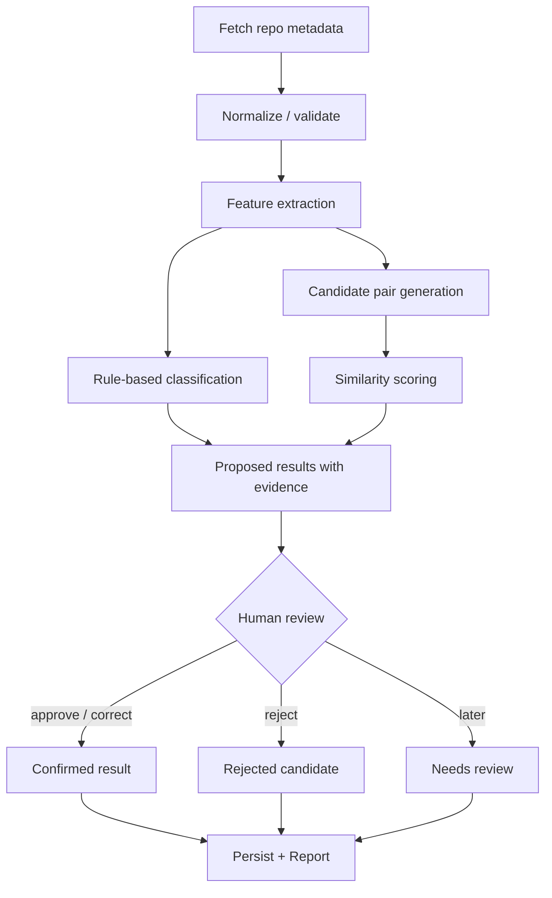
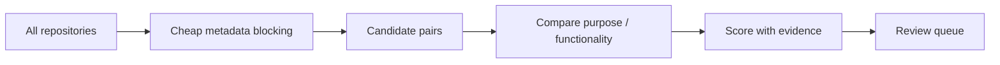
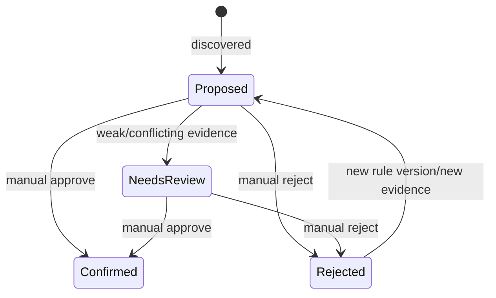

# RepositoriesManager — 分類・類似候補検出仕様

> Status: Draft / アルゴリズム未確定  
> 更新日: 2026-10-12  
> 対応: `DOMAIN_MODEL.md`, `REQUIREMENTS.md`

## 1. 目的

リポジトリの**分類候補**と**類似候補**を、再現可能な根拠とともに提示する。重複の確定・統合・削除を自動で決めない。

## 2. 処理を分ける

| 処理 | 入力 | 出力 | 決めないこと |
|---|---|---|---|
| 分類（Classification） | 単体Repoのメタデータ | Type / Domain / Lifecycleの**候補** | Repositoryの削除 |
| 類似検索（Similarity） | Repoのペアと特徴量 | スコア・比較根拠付き候補 | 実際に重複しているか |
| 関係推定（Relation Suggestion） | 類似候補、README等 | `overlaps-with`などの**提案** | Relationの確定 |
| 整理判断（Disposition） | 候補と利用者の判断 | keep / merge / archive / delete-candidate | GitHubへの破壊操作 |

## 3. 分類軸と意味

| 軸 | 値・数 | 根拠 | 失敗時 |
|---|---|---|---|
| Type | 標準候補から最大1件を確定 | README、Description、構成 | unknown（未分類） |
| Domain | ユーザー定義、複数可 | GitHub Topics、語彙辞書 | 空リスト |
| Lifecycle | active / paused / completed / superseded / abandoned / unknown | 活動証拠＋人間の判断 | unknown |
| Disposition | keep / merge / archive / delete-candidate / undecided | ユーザー判断 | undecided |

- **更新日だけでLifecycleを`abandoned`にしない。** 完成したライブラリや記事サンプルは長期間更新がなくても正常。
- `Domain`は`Project`と同義ではない。分類が同じでもプロジェクトは別かもしれない。
- Typeの分類不能は`other`と区別する。`other`は人間が意図的に選べる分類。

## 4. データ・証拠・品質

| フィールド | 用途 | 優先度 |
|---|---|---|
| ID / owner / name | 同定・検索 | 必須 |
| description / topics | 分類・類似 | 取得できれば使用 |
| README | 目的・機能・技術の補助証拠 | 任意。コスト制限 |
| archived / fork / timestamps | 観測・候補表示 | 可能な範囲 |
| language / file structure | Type補助 | 拡張候補 |
| issue / PR / deployment | 実運用の判断材料 | MVPの必須条件にしない |

欠損と空文字を区別し、未取得フィールドを「一致なし」と断定しない。private repoの情報はローカル保存とレポートで漏えい対策を行う。

## 5. 処理フロー



## 6. MVPの分類ルール

| ルールID | 条件の例 | 推奨候補 | 注意 |
|---|---|---|---|
| TYPE-CLI | READMEにCLIの利用手順と実行コマンド | `cli` | 文章中のCLI言及だけで確定しない |
| TYPE-LIB | READMEにライブラリ利用・import例 | `library` | sample repoとの混同に注意 |
| TYPE-TEMPLATE | テンプレート用途の明示・template metadata | `template` | GitHub templateフラグ優先 |
| TYPE-DOC | 文書中心で実行コードが主ではない | `documentation` | 単にREADMEが長いだけでは不足 |
| TYPE-LEARN | 明示的な学習・演習目的 | `learning` | `train`という名前だけでは弱い |
| DOMAIN-TOPIC | Topicsが既知のユーザー定義slugに対応 | `domain`ラベル | 語彙辞書の版を記録 |
| LIFE-ARCHIVED | GitHub archived=true | 事実として表示 | `completed`/`abandoned`は**推定しない** |

Type候補が競合するときは複数の提案を保存できるが、**確定値は最大1つ**。ルールにヒットしない場合は未分類。

## 7. 類似候補の生成

全件の組合せを無条件に高コストなREADME比較にかけない。以下の軽量な「候補抽出（blocking）」を先に行う。

1. リポジトリ名から共通の語幹・特徴語を抽出する（`next`, `v2`, `test`などの汎用語を減点）。
2. Descriptionの特徴語の重なりを確認する。
3. TopicsとDomain候補の共有を確認する。
4. 同じProjectへの所属情報があれば**比較対象の候補に含める**。同一Project = 重複とはしない。
5. 候補集合のみ必要に応じてREADMEの比較へ進む。



## 8. スコアリング方針

### 初期段階のルール

MVPでは、**重みの合計が100%になる独断の固定式は採用しない。** まず分類根拠・一致条件・差異を構造化して提示する。

仮の出力例：

```json
{
  "left": "UtakataKyosui/bookshelf",
  "right": "UtakataKyosui/bookshelf-next",
  "score": null,
  "matched_signals": ["name_tokens:bookshelf", "readme_template"],
  "conflicts": [],
  "explanation": "同系統の名称とREADMEの雛形が共通。実装の重複は未確認。",
  "status": "needs-review",
  "rule_version": "rules-v0"
}
```

`score: null`は評価基準未導入を意味する。導入する場合は0〜1に正規化し、次の条件を満たす。

- 特徴量・重み・閾値・規則バージョンを設定として記録する。
- 評価用の正解ペア集合を作り、Precision/Recallを測定する。
- READMEが欠損しても、欠損=不一致とはせず「信頼度低下」を示す。
- 高スコアであっても`Relation.duplicates`に自動確定しない。
- 初期MVPでは順位付けを行えるだけでも十分。スコアがなくても提示可能。

## 9. 候補とレビューの状態



人間による確定値は再スキャンで保持する。候補に追加証拠が見つかった場合は、変更差分として提示する。

## 10. サンプル評価ケース

| ケース | 期待される動作 |
|---|---|
| `bookshelf` / `bookshelf-next` | 類似候補として提示できる。READMEの共通雛形だけで「重複確定」しない |
| `okr-hub` / `okr-web` | 同じProjectの別コンポーネントであり得る。名前類似だけで統合提案しない |
| `astro-portfolio-with-blog` / `tanstack-portfolio` | 後継の可能性を調査候補として表示。確定しない |
| 完成後に長期間更新のない記事サンプル | 自動で`abandoned`と判定しない |
| GitHub rename後の同一Repository ID | 既存レビュー結果を引き継ぐ |
| GitHub APIの途中失敗 | 欠損を明示し、未取得を削除扱いにしない |
| 手動確定Typeに別の新規推論 | 確定Typeを保持し、競合候補を別表示 |

## 11. 評価データセットと指標

代表的なRepositoryペアを20〜30組、**重複・後継・関連・無関係・判定保留**に人手でラベル付けして評価データとする。肯定例だけでなく、名称が似ていても別用途というhard negativeを含める。

| 指標 | 意味 | MVPでの扱い |
|---|---|---|
| Candidate Recall | 正解の関連/重複ペアが候補に残る割合 | 重要。見落としを抑える |
| Precision@K | 上位K件の候補のうち有用な割合 | ユーザーのレビュー負担 |
| False Positive | 無関係なペアを提案した数 | 説明と却下フローで抑制 |
| Human Correction Persistence | 人間による訂正が保持されるか | 必須テスト |
| Runtime / API Calls | 数百件に対する実行費用 | ベースライン測定 |

閾値や合格値はテスト集合を使って決める。事前に恣意的な数値を保証値として置かない。

## 12. CLI / TUIとの契約

- 提案には`repository_id`, `axis/type`, `suggested_value`, `evidence`, `rule_version`, `review_status`を含む。
- 類似候補にはRepoのペア、理由、相違点、根拠の取得状況を含む。
- CLIのJSON出力は機械可読とし、説明文の変更がパーサーを壊さない形式にする。
- TUIは未確認・確定・却下を区別して表示し、承認・訂正・保留ができる。
- LLM導入時も同一の提案モデルに正規化する。LLM出力を確定値として扱わない。

## 13. 非目標とセーフティ

- `archive` / `delete-candidate`を検出・記録してもGitHubへの操作は行わない。
- 個人の非公開READMEを外部LLMに送信しない（明示許可・範囲指定・費用説明なし）。
- `gh repo edit`の既存機能は**分類の承認**とは別操作。GitHub変更は差分確認を必須とする。
- リポジトリが見つからないときに即座に「削除された」と扱わない。

## 14. 未決定事項

| ID | 検討事項 | 決めるための材料 |
|---|---|---|
| CL-01 | 特徴量と重み | 評価用ペアとレビュー結果 |
| CL-02 | README取得範囲 | APIコスト、プライバシー、精度 |
| CL-03 | ルールのユーザー定義形式 | JSON/YAMLの保守性 |
| CL-04 | Domainの初期辞書 | 対象リポジトリの実サンプル |
| CL-05 | スコア閾値 | Precision/Recall |
| CL-06 | LLM導入 | ルール方式で不足する事例の計測 |
