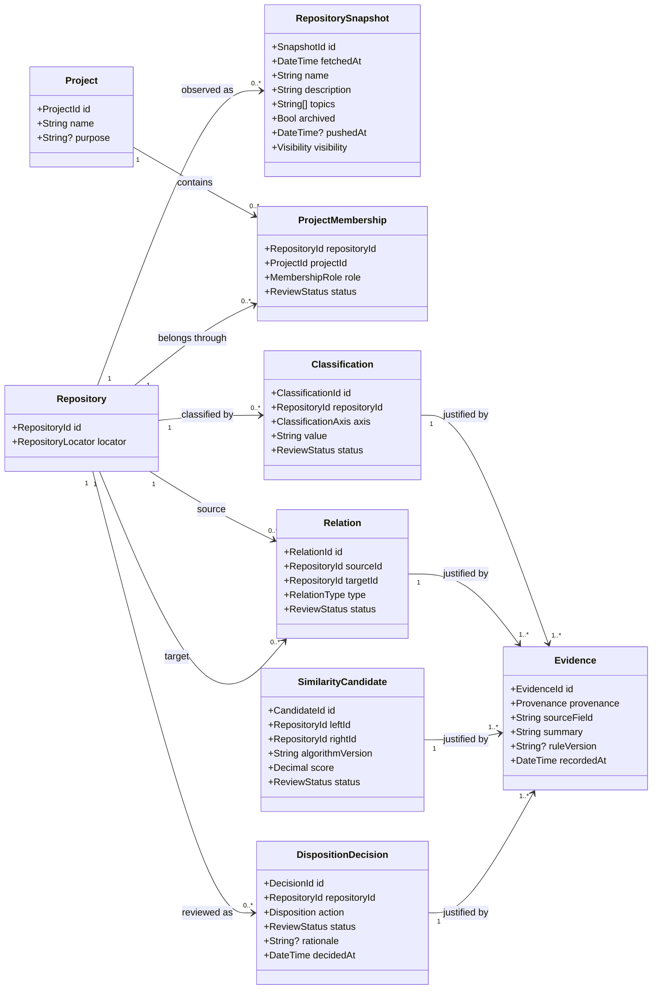
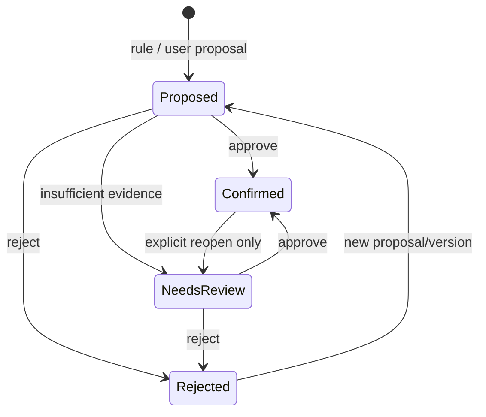
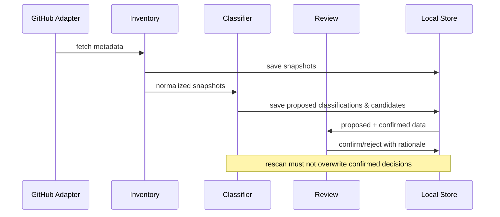

# RepositoriesManager — ドメインモデル

> Status: Draft / 要レビュー  
> 更新日: 2026-10-12  
> 対応文書: `REQUIREMENTS.md`, `ARCHITECTURE.md`, `CLASSIFICATION_SPEC.md`  
> 対象: `UtakataKyosui/RepositoriesManager`

## 1. 目的と設計原則

本書はGitHubリポジトリの**観測・分類・関係付け・整理判断**に必要なドメイン概念を定義する。Rustの型定義・永続化形式・UIの実装から独立した論理モデルとする。

- **Repository ≠ Project**：RepositoryはGitHub上のコード保管単位、Projectは複数Repositoryを束ね得る取り組み。
- **Category ≠ Group**：Categoryは分類軸上のラベル、Projectは目的を共有する単位。検索時のグルーピング結果は独立した永続エンティティとしない。
- **Similarity ≠ Relation ≠ Disposition**：似ていること、実際に関係があること、整理すべきことは別。
- **Observed / Inferred / Confirmed** を明示し、自動推論で手動確定を上書きしない。
- リポジトリ削除・アーカイブはこのドメインの**提案対象**であって、MVPの実行操作ではない。
- GitHubの認証情報をドメインモデルに保存しない。

## 2. コンテキスト境界

| 境界 | 扱うもの | 扱わないもの |
|---|---|---|
| Inventory | GitHubから取得したRepositorySnapshot | Github API・CLI実装 |
| Classification | Type / Domain / Lifecycleの割当と根拠 | 画面の表示状態 |
| Relationship | Projectの所属、Repository間の関係 | 名前が似ているだけの確定関係 |
| Review | 推測の承認・却下、整理方針 | 実際の削除処理 |
| Reporting | 時点付きの棚卸し結果 | GitHubへの書き込み |

## 3. 概念クラス図（ドメインの論理構造）

**注記:** Mermaidでは型や集約境界の厳密な制約を表し切れないため、下表と不変条件を正本とする。`Evidence` は同一根拠を複数の判定が参照してもよい。クラス図の結線は参照関係を説明するもので、物理テーブル構造を指定しない。

## 4. エンティティと識別子

| 概念 | 識別子 | 特徴 | 所有者 |
|---|---|---|---|
| Repository | GitHub repository IDを基本とする`RepositoryId` | rename後も同一実体を追跡。`owner/name`はLocator | Inventory |
| RepositorySnapshot | `SnapshotId` | 取得時点の不変な観測記録 | Inventory |
| Project | ローカル発行の`ProjectId` | GitHub Projectsとは別概念 | Relationship |
| ProjectMembership | ProjectId + RepositoryId | 所属する役割と確認状態 | Relationship |
| Classification | `ClassificationId` | 軸・値・出所・確認状態 | Classification |
| Relation | `RelationId` | 向きと関係種別を持つ | Relationship |
| SimilarityCandidate | 規則バージョン付きペアID | **候補**。事実ではない | Classification |
| DispositionDecision | `DecisionId` | keep等の提案または人間の判断 | Review |
| Evidence | `EvidenceId` | 原因・出典・規則バージョン | 共通 |

`RepositoryLocator` は `owner/name` とURLを保持する。GitHub IDを取得できないオフライン入力は暫定IDとして取り込み、同定されるまで重複統合しない。

## 5. 列挙型と値オブジェクト

| 型 | 値 | 意味・制約 |
|---|---|---|
| `ClassificationAxis` | `type`, `domain`, `lifecycle` | 互いに独立 |
| `RepositoryType` | `application`, `library`, `cli`, `template`, `documentation`, `learning`, `other` | 1件につき確定値は最大1つ。未分類可 |
| `Domain` | ユーザー定義slug | 複数可。標準候補は初期値であり固定enumではない |
| `Lifecycle` | `active`, `paused`, `completed`, `superseded`, `abandoned`, `unknown` | 更新日時だけで確定しない |
| `RelationType` | `related-to`, `part-of`, `successor-of`, `overlaps-with`, `duplicates` | 方向性は§7 |
| `Disposition` | `keep`, `merge`, `archive`, `delete-candidate`, `undecided` | 破壊的操作そのものではない |
| `Provenance` | `observed`, `inferred`, `confirmed` | **根拠の取得由来**と人の承認を区別 |
| `ReviewStatus` | `proposed`, `confirmed`, `rejected`, `needs-review` | 各提案の審査状態 |
| `MembershipRole` | `primary`, `component`, `experiment`, `documentation`, `other` | プロジェクト内の役割 |

`Provenance`と`ReviewStatus`は直交する。例：観測したREADMEを証拠として、自動推論した分類提案（`inferred`, `proposed`）をユーザーが承認（`confirmed`）する。承認は証拠の観測値を変更しない。

## 6. Project所属のルール

- MVPでは、Repositoryに対する**確認済みのPrimary Project所属は0または1件**。未所属を許可。
- 関連する別Projectへの所属が必要な場合は、後続版で多重所属を検討。現段階ではRelationやDomainで表現する。
- 例：`okr-hub` と `okr-web` は同一Projectに所属し得るが、重複とは限らない。
- ProjectはRepositoryが0件でも作成可能。ただしMVPでProjectの編集UIを必須としない。

## 7. Relationの意味と不変条件

| RelationType | 方向 | 解釈 | 例 |
|---|---|---|---|
| `related-to` | 対称 | 何らかの関連。意味は根拠に記述 | 共通ドメイン |
| `overlaps-with` | 対称 | 機能・責務が重なるが同一とは限らない | 部分的に同じCLI |
| `duplicates` | 対称 | 実質同じ目的・役割の重複と人が確認 | 旧試作と複製 |
| `successor-of` | 有向 | `source`が`target`の後継 | 新実装 → 旧実装 |
| `part-of` | 有向 | `source`が`target`の構成部分 | サブRepo → 親Repo |

- `sourceId != targetId`。自己Relationは禁止。
- 対称関係はRepositoryIdの正規化順序で一意化する。
- 同じペアに異なる種類のRelationは共存可能。ただし矛盾を警告する。
- `successor-of` と `part-of` は循環を検知し、確定前に警告または拒否する（運用方針はADR）。
- 関係が推測されても、承認なしに確定Relationへ昇格しない。
- 存在しないRepositoryへの参照は拒否するか未解決参照として隔離する。

## 8. 判定と履歴の状態遷移

- スキャンのたびに`RepositorySnapshot`は更新・追加されるが、確定済み`Classification`と`DispositionDecision`は自動上書きしない。
- 推測値の再評価は新しい候補または候補バージョンとして扱う。
- 判定の変更では、旧値・新値・理由・時刻をイベントとして記録する。将来の`DecisionHistory`永続化はAdapterで実装する。
- `delete-candidate`は削除操作ではない。ユーザーの意思決定ログにとどめる。

## 9. 境界間のデータフロー

## 10. アプリケーションへの公開操作

| Use Case | 入力 | 出力 | 副作用 |
|---|---|---|---|
| `ScanRepositories` | GitHub account, paging config | `ScanResult`, snapshots | ローカル保存のみ |
| `SuggestClassification` | snapshot ID, rule version | classification proposals | ローカル保存のみ |
| `FindSimilarRepositories` | snapshot set, algorithm config | candidates + evidence | ローカル保存のみ |
| `AssignRepositoryToProject` | repository ID, project ID, role | membership | ローカル保存のみ |
| `ReviewSuggestion` | suggestion ID, approve/reject, rationale | review result | ローカル保存のみ |
| `SetDisposition` | repository ID, decision, reason | disposition decision | ローカル保存のみ |
| `ExportAuditReport` | filter, snapshot selection | Markdown/JSON | ファイル出力 |

旧TUIのDescription/Topics編集は**明示的なGitHub書き込みUse Case**として隔離する。MVPの棚卸し系Use Caseには含めない。

## 11. 実装前に検証すべき不変条件

1. RepositoryのGitHub上のrename後も、同じGitHub IDなら判断履歴を引き継ぐ。
2. 一つのRepositoryにつき確定Typeは最大1件、確定Lifecycleも最大1件。
3. Domainは重複slugを持たず、複数登録できる。
4. 手動確定値は再スキャンおよび規則バージョン更新で変わらない。
5. 対称Relationは`A↔B`と`B↔A`が同一扱い。
6. RelationとSimilarityCandidateは混同しない。
7. Dispositionの`delete-candidate`から削除コマンドは実行されない。
8. スナップショット取得が部分失敗した場合、未取得のRepositoryを削除済み扱いしない。

## 12. 未決定事項（ADR候補）

| ID | 論点 | 暫定案 |
|---|---|---|
| DM-01 | Projectの多重所属 | MVPはPrimary 1件、将来拡張 |
| DM-02 | Relationshipの循環 | 警告と確定拒否の境界を検討 |
| DM-03 | 類似ペアの永続化 | 計算結果のバージョンを保存 |
| DM-04 | ローカル保存方式 | JSON開始、Repositoryで抽象化 |
| DM-05 | 旧ProjectDependencyの扱い | 直接移植せず`Relation`と用途を比較 |
| DM-06 | 人間の承認記録 | 単一ユーザーでも理由・時刻を保持 |

## 13. 既存資産との対応

| 旧実装 | 新モデル |
|---|---|
| `RepositoriesManager/src/main.rs` の `Repository`, `Topic` | GitHub取得DTO → `Repository` と `RepositorySnapshot` |
| TUIの `AppMode` / `EditField` | Presentation State。Domainに移さない |
| `RepositoriesAndProjectManager` の Prisma `Project` | `Project` 概念の参考 |
| 同 `Repository`（Project所属） | `ProjectMembership` として明示 |
| 同 `ProjectDependency` | `Relation` と区別。後続でProject間依存が必要なら別モデル |

**実装の正本はRust Domain Core。** この図は`crates/core`の設計入力であり、Cargo crate境界を過剰に固定するものではない。
