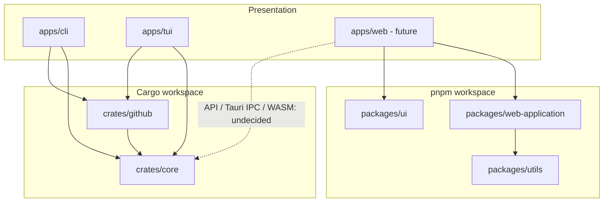
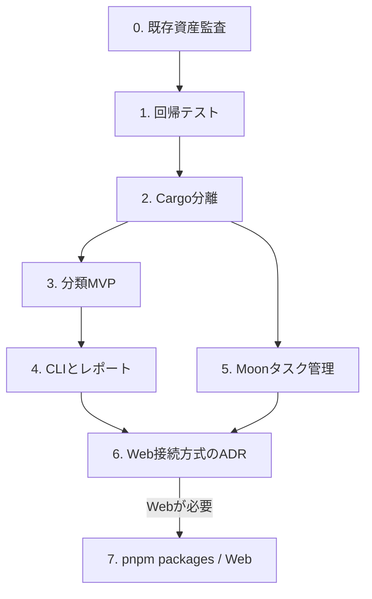

# RepositoriesManager — 既存資産を利用した再開発計画

> Status: Proposed / 2026-10-12  
> 対応仕様: `REQUIREMENTS.md` / `ARCHITECTURE.md`

## 1. 原則

- **既存 `RepositoriesManager` を唯一の開発元**とする。新しい類似リポジトリは作らない。
- Rustのドメイン・分類ロジックを正本とし、CLI/TUIはその利用者とする。
- `cargo workspace` はRust依存とビルド、`pnpm workspace` はWeb/TS依存、`moonrepo` は横断タスクのオーケストレーションを担当する。
- Web側を作るためだけにRust CoreをTypeScriptへ再実装しない。
- 既存コードは**現状の挙動をテストで押さえてから**移動する。既存実装を未確認のまま破棄しない。
- 開発中はリポジトリを削除・アーカイブしない。

## 2. 既存コード監査（確認済みと未確認を区別）

| 資産 | 確認した根拠 | 再利用判断 | 移行先 |
|---|---|---|---|
| `RepositoriesManager/src/main.rs` | Ratatui/Crossterm、`App`、一覧選択、編集モード | **実装を段階的に抽出して再利用** | `apps/tui` |
| Repository/Topic型 | `src/main.rs`にSerde型 | **API DTOとDomainを分離して再利用** | `crates/github`, `crates/core` |
| `gh repo edit`呼び出し | Description/Topics更新 | **Adapterとして抽出**。副作用はUIに明示 | `crates/github` |
| `RepositoriesManager/Cargo.toml` | Rust edition 2024、ratatui 0.29、crossterm 0.28、serde、tokio等 | **既存依存を維持して起動互換を確認** | Cargo workspace |
| `RepositoriesAndProjectManager/prisma/schema.prisma` | `Project`, `Repository`, `ProjectDependency`, `Roadmap` | **ProjectとRepositoryの分離概念を参照**。Prisma実装は直輸入しない | `crates/core`の設計参考 |
| 同リポジトリ `package.json` | Next.js、Prisma、Better Auth、React Flow等 | **技術的参考資料**。Web側の必須依存にはしない | 必要時のみ `apps/web` |
| 同リポジトリREADME | 別テンプレート名の短い記述 | **仕様の証拠としては不十分** | 移植せず保持 |

未確認: Rustの全コードパスとE2E動作、Web側UI実装、既存DBデータ、デプロイ、利用実績。これらの監査を最初のIssueで行う。

## 3. 再開発後の配置案

```text
RepositoriesManager/
├── .moon/
│   ├── workspace.yml
│   └── tasks/
├── apps/
│   ├── cli/               # Rust/非対話コマンド
│   ├── tui/               # Rust/イベント・状態・描画
│   └── web/               # 将来のWeb UI（MVPでは作らない）
├── crates/
│   ├── core/              # Repository/Project/分類/ユースケース
│   └── github/            # gh Gateway + DTO変換
├── packages/
│   ├── web-application/   # 将来のWeb固有ロジック
│   ├── ui/                # Web UI components
│   └── utils/             # TS共通関数
├── contracts/             # 必要時の境界スキーマ
├── docs/
│   ├── REQUIREMENTS.md
│   ├── ARCHITECTURE.md
│   └── REDEVELOPMENT_PLAN.md
├── Cargo.toml
├── pnpm-workspace.yaml
└── package.json
```

上記の将来ディレクトリは**初期から空で大量作成しない**。必要なパッケージが生じた段階で追加する。

## 4. 依存方向



**注意:** 実際の依存では `core` 内に外部Gateway実装を置かない。`github`がCoreのインターフェースを実装し、Composition Rootで結合する。図のTUI→GitHubは起動時の配線依存を示す。

## 5. 開発フェーズと終了条件

| Phase | 内容 | 成果物 | Exit criteria |
|---|---|---|---|
| 0. ベースライン | 既存2repoのtree/主要機能/未完了Issue/実行方法/データ資産を監査 | `docs/LEGACY_AUDIT.md` | 再利用/破棄/保留一覧が根拠付き |
| 1. 保護 | 現行TUIの起動・一覧・編集の回帰テスト、fixture追加 | テスト/動作記録 | リファクタ前後で主要操作が再現できる |
| 2. Cargo分離 | `src/main.rs`からDomain・GitHub Adapter・TUIを抽出 | `crates/core`, `crates/github`, `apps/tui` | 旧機能が正常動作、`cargo test --workspace` 成功 |
| 3. 分類MVP | スキャン、分類、根拠、ユーザー確定、ローカル保存 | CoreとTUI分類画面 | FR-01〜07の受け入れシナリオ成功 |
| 4. CLI/レポート | 非対話CLI、JSON/Markdown出力、安定終了コード | `apps/cli` | CIでCLI出力を検証できる |
| 5. Moon導入 | cargo/pnpmの仕事をmoonのタスクに登録 | `.moon/*` | moon経由・直接実行の両方が動く |
| 6. Webの判断 | Webユーザーストーリーと接続方式ADR作成 | ADR / PoC（必要時） | 実装する/しないの根拠が明記される |
| 7. Web実装（任意） | `apps/web`, `packages/*` を追加 | Webアプリ | Rust Coreの二重実装なしで利用できる |

**工程上の注意:** moonrepoを最初から全パッケージへ拡大しない。Phase 2〜4でCargo側の安定したタスクを確定させ、Phase 5でビルドフローへ乗せる。pnpmはWebの要件が確定するまでは設定だけ先行してもよいが、空パッケージは不要。

## 6. 作業依存関係



## 7. Issue分解案

| Epic | Sub Issue例 | 受け入れ条件 |
|---|---|---|
| E1 Legacy Audit | ディレクトリと実装調査 / Web側のProjectモデル評価 / 未完了Issue調査 | 移植対象に出典と理由がある |
| E2 Safe Refactor | ghコマンドをAdapter化 / Domain型抽出 / TUI StateとUI分離 / 回帰テスト | 既存の操作が維持される |
| E3 Repository Inventory | 全件ページング / エラー・Rate Limit / スナップショット | 大量repoでも欠落を検知 |
| E4 Categorization | Type/Domain/Lifecycle / 分類根拠 / 手動確定 / 永続化 | 再スキャンで確定情報が保持 |
| E5 Relationship Audit | 類似候補 / Project所属 / 後継と重複 / 整理判断 | 根拠を確認して確定できる |
| E6 Headless Interface | CLIサブコマンド / JSON / Markdown / exit codes | CIから使用可能 |
| E7 Build Orchestration | Cargo/pnpm連携 / moon tasks / CIキャッシュ | 直接実行とmoon経由が整合 |
| E8 Web Decision | UX要件 / Rust接続方式ADR / PoC | Web実装可否の意思決定 |

## 8. 特に避けること

1. 既存TUIの機能を失ったまま全面書き直しする。
2. `RepositoriesAndProjectManager` の認証・Prisma・Roadmapを要件確認せず全部移植する。
3. RepositoryとProjectを1対1と決め打ちする。
4. 候補の推論をConfirmedとして扱う。
5. 更新日だけで削除判断を行う。
6. moonrepo導入を理由にCargo/pnpmの単独実行を壊す。
7. Webの接続方式を未検証のままWASM/HTTP/Tauriのどれかに固定する。

## 9. Definition of Done

- [ ] 既存機能の回帰テストが通る
- [ ] Domain/Adapter/UIの境界に循環依存がない
- [ ] 取得失敗・欠損・Rate Limitを扱える
- [ ] 分類根拠とユーザー確定を区別できる
- [ ] 再スキャンで確定結果を上書きしない
- [ ] GitHubを書き換えずに棚卸しレポートを作れる
- [ ] CLIに機械可読出力と終了コードがある
- [ ] moonrepoを使わずに各Workspaceをテストできる

## 10. 参照と判断記録

- [RepositoriesManager](https://github.com/UtakataKyosui/RepositoriesManager): 既存Rust TUI
- [RepositoriesAndProjectManager](https://github.com/UtakataKyosui/RepositoriesAndProjectManager): 旧Web構想とPrismaのProjectモデル
- `REQUIREMENTS.md`: 目標と受け入れ条件
- `ARCHITECTURE.md`: 詳細アーキテクチャ

すべての既存コードの調査を終えたという意味ではない。Phase 0で調査範囲を広げ、再利用可否を更新する。
