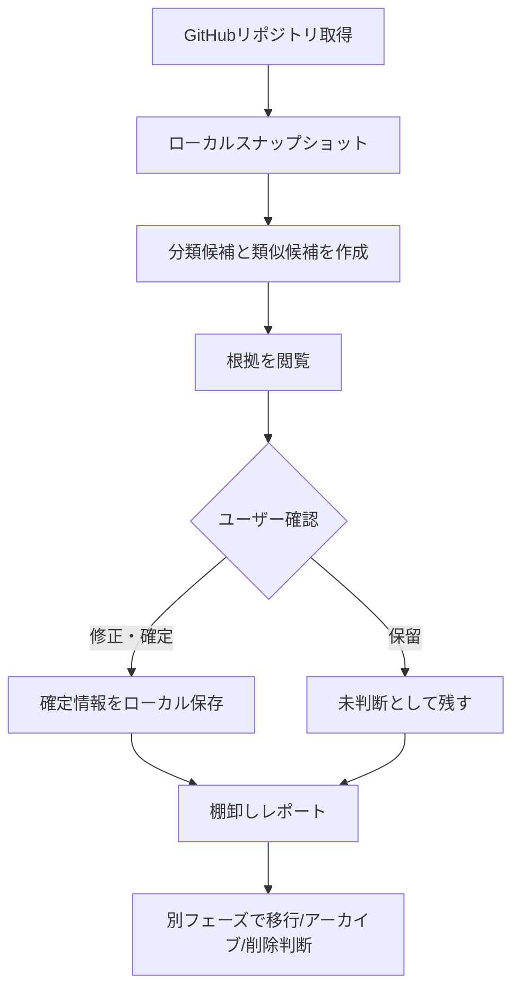

# RepositoriesManager — 要求仕様書

> Status: Draft / 2026-10-12  
> Scope: 既存の `UtakataKyosui/RepositoriesManager` を継続開発する。ここに記載する分類・関係は仕様案であり、実リポジトリへの操作は未実施。

## 1. 背景と問題

個人GitHubに多数のリポジトリがあり、目的の重複、開発の停止、後継プロジェクトへの移行、保持価値の違いを一覧では判断しにくい。更新日が古いという理由だけで削除すると、完成済みの成果物や他から参照されるサンプルを失う危険がある。

**問題:** リポジトリの名前を整理することではなく、維持・統合・アーカイブ・削除を根拠付きで判断できないこと。  
**目的:** GitHubの観測データとユーザーの意思決定を分け、棚卸し可能な状態を作る。

## 2. 成功条件と対象者

| ID | 成功条件 | 検証方法 |
|---|---|---|
| GOAL-01 | 所有リポジトリを漏れなく確認できる | ページングした取得件数・取得エラーを表示 |
| GOAL-02 | 各リポジトリを分類済み／未分類として管理できる | 分類一覧と未分類フィルタ |
| GOAL-03 | 重複・関連・後継の候補を根拠付きで提示できる | 候補に根拠と確認状態がある |
| GOAL-04 | ユーザーの判断を後で再現できる | 再起動・再スキャン後に確定分類が保持される |
| GOAL-05 | 読み取り専用の操作でMVPを完結できる | API書込・削除を行わずレポート作成 |

主対象は自分のGitHubリポジトリを多数管理する個人開発者。将来は他の開発者への配布を想定するが、多人数協調はMVP対象外。

## 3. 用語と分類軸

| 軸 | 例 | 制約 |
|---|---|---|
| Type | application / library / cli / template / documentation / learning / other | 原則1つ。未分類を許可 |
| Domain | book-management / portfolio / developer-tools / life-management | ユーザー定義、複数可 |
| Lifecycle | active / paused / completed / superseded / abandoned / unknown | 最終更新日から断定しない |
| Disposition | keep / merge / archive / delete-candidate / undecided | **提案とユーザー確定を区別** |
| Relation | related-to / part-of / successor-of / overlaps-with / duplicates | 方向のあるものとないものを区別 |
| Provenance | observed / inferred / confirmed | 取得事実、推論、承認済みを混在させない |

`Repository` と `Project` は同一ではない。Projectは目的・成果のまとまりであり、複数のRepositoryを含みうる。

## 4. 機能要件

| ID | 優先度 | 要件 | 主な受け入れ条件 |
|---|---|---|---|
| FR-01 | Must | GitHubから所有リポジトリを全件取得 | 100件超をページングし、途中失敗を可視化 |
| FR-02 | Must | 名前、説明、URL、Topics、Archived等を閲覧 | 取得可能な値と不明を区別 |
| FR-03 | Must | Type、Domain、Lifecycleを設定・修正 | 未分類と複数Domainに対応 |
| FR-04 | Must | 分類根拠と由来を保存 | observed/inferred/confirmedを識別 |
| FR-05 | Must | 類似候補を抽出 | 名前/説明/Topics等の根拠を表示。自動で重複確定しない |
| FR-06 | Must | 整理判断を記録 | keep/merge/archive/delete-candidate/undecidedを区別 |
| FR-07 | Must | ローカル永続化 | 再実行・再スキャンで確認済みデータが消えない |
| FR-08 | Must | JSON/Markdownレポート出力 | 同じ入力に対して安定した形式で出力 |
| FR-09 | Must | TUIの既存一覧・Description/Topics編集を維持 | 回帰テスト、従来操作が継続利用できる。ただし編集は明示確認 |
| FR-10 | Should | 種類・状態・Domainによるフィルタ | 未分類・整理候補を抽出できる |
| FR-11 | Should | Repository間の関係を確定できる | 参照先の存在、重複関係の表現を検証 |
| FR-12 | Could | Web UIで可視化 | Webの要求とRust接続方式決定後に着手 |
| FR-13 | Could | LLMによる意味解析 | 明示有効化・コスト可視化・ユーザー承認 |
| FR-14 | Could | GitHub Topicsへの分類同期 | 差分・確認・ロールバック方針決定後 |

### 既存編集機能の扱い

旧TUIのDescription/Topics編集は維持対象。ただしMVPの新しい棚卸しフローはデフォルトでGitHubを変更しない。既存編集コマンドの副作用はUIに明示し、実行前に差分を示す。

## 5. 非機能要件

| ID | 要件 | 基準 |
|---|---|---|
| NFR-01 | 安全性 | 削除・アーカイブの自動実行なし。破壊的操作はMVP除外 |
| NFR-02 | セキュリティ | 認証は既存 `gh` を優先し、トークンをログ・成果物へ書かない |
| NFR-03 | 耐障害性 | API失敗・Rate Limit・欠損フィールドを明示 |
| NFR-04 | 再現性 | 分類ルールのバージョンと手動確定を記録 |
| NFR-05 | パフォーマンス | 465件規模を現実的に閲覧できる。数値目標はベースライン測定後に確定 |
| NFR-06 | テスト | Domainの純粋ロジックはGitHub通信なしでテスト可能 |
| NFR-07 | 操作性 | CLIは非対話・JSON出力・意味のある終了コードを持つ |
| NFR-08 | ポータビリティ | Cargoとpnpmのワークスペースを独立して実行できる |

## 6. スコープ外

- リポジトリの自動削除、自動アーカイブ、無承認のGitHub書込
- GitHub Issues/Projects全体の管理ツール化
- Web認証基盤、マルチテナント、ホスト型バックエンド
- Rust/TypeScript双方への分類アルゴリズムの二重実装
- LLMを使った無条件の分類確定

## 7. 主要ユーザーフロー

## 8. MVP受け入れシナリオ

1. GitHub認証済み環境からリポジトリをスキャンし、取得件数と失敗件数を確認できる。
2. `bookshelf` と `bookshelf-next` が類似候補として出ても、ユーザー承認なしには重複と確定されない。
3. `okr-hub` と `okr-web` を同一Projectの異なる役割として登録できる。
4. 特定リポジトリのLifecycleを `unknown` から `completed` に手動変更し、再起動後も維持される。
5. レポートには候補・確定・不明が明示され、操作だけでリポジトリが削除されない。

## 9. 未決定事項

| ID | 論点 | 暫定方針 |
|---|---|---|
| D-01 | 永続化方式 | MVPはローカルJSON等から開始、SQLite移行余地を確保 |
| D-02 | WebからRust Coreへの接続 | HTTP / Tauri IPC / WASMを比較後決定 |
| D-03 | 分類ルール体系 | Typeは初期標準、Domainはユーザー定義 |
| D-04 | 既存TUIの編集仕様 | 差分確認とGitHubへの副作用の明示を追加 |
| D-05 | `RepositoriesAndProjectManager` の資産 | Project関連の概念モデルのみ先行採用、コード移植は要検証 |

## 10. 参照

- [RepositoriesManager](https://github.com/UtakataKyosui/RepositoriesManager)
- [RepositoriesAndProjectManager](https://github.com/UtakataKyosui/RepositoriesAndProjectManager)
- `ARCHITECTURE.md`（別紙）
